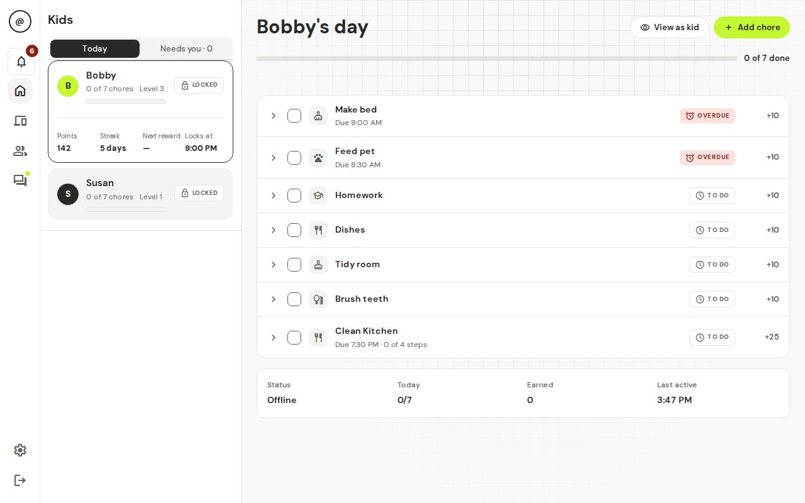

# t@sk4ce

Chores first, then screens. t@sk4ce is a free family app where kids do their chores, parents approve them, and the home internet only switches on once the chores are done. It runs on a small computer in your home, so your family's data stays in your house.

**Website and setup help: https://sgtslaughta.github.io/tskfrce/**

**📖 [Full beginner's guide online](https://sgtslaughta.github.io/tskfrce/guide/) — step-by-step for parents, no technical knowledge needed.**



## What you get

- **Chores that stick.** Create a chore once, give it to one kid or several (each, race or team), and repeat it daily, on some days or just once. Add steps and ask for a photo as proof.
- **Approve or send back.** One screen ("Needs you") shows everything waiting for a decision.
- **Points, levels and rewards.** Approved chores earn points. Kids level up, earn badges, unlock flair in the Locker, and spend points on rewards or extra screen time.
- **Chat.** A thread for every chore, a private chat for each kid, and a family chat.
- **Internet that follows the chores.** Pick which devices are paused until their chores are approved, plus allowed hours and free time.

It is honest about its limits: a determined kid can get around it (a phone hotspot, a different device). The app tells you when it notices. If the home box is switched off, the internet simply works.

## Get started (about 20 minutes)

**👉 [Go to the full guide →](https://sgtslaughta.github.io/tskfrce/guide/)**

Or here's the short version:

1. [See what you need](https://sgtslaughta.github.io/tskfrce/guide/01-what-you-need.html): a small always-on computer and an ordinary home router.
2. [Install t@sk4ce](https://sgtslaughta.github.io/tskfrce/guide/02-install.html): copy and paste one line.

   ```bash
   curl -fsSL https://sgtslaughta.github.io/tskfrce/install.sh | sh
   ```

3. [Do the first-time setup](https://sgtslaughta.github.io/tskfrce/guide/03-first-setup.html): add your family, kids and devices.
4. [Learn the everyday routine](https://sgtslaughta.github.io/tskfrce/guide/04-everyday-use.html): approve chores, answer requests, give rewards.
5. [Show your kids](https://sgtslaughta.github.io/tskfrce/guide/05-for-kids.html): a one-page guide you can hand over.

Something wrong? See [Troubleshooting](https://sgtslaughta.github.io/tskfrce/guide/06-troubleshooting.html) and the [FAQ](https://sgtslaughta.github.io/tskfrce/guide/07-faq.html).

## For developers

Architecture, data model, security notes and how to add badges or flair: [docs/engineering.md](docs/engineering.md).

Forgot a parent password? Another parent can make a reset link in Settings, or run `cd ~/task4ce && docker compose -f docker-compose.prod.yml exec backend python -m app.cli reset-password <name>` on the box.

Layout: `backend/` (FastAPI + SQLite), `frontend/` (Next.js), `blocker/` (the home box service), `lab/` (an isolated Docker network for tests).

### Run it

Needs Docker with Compose. The `blocker` service needs Linux (it uses host networking), so on macOS or Windows run only the app services.

```bash
printf 'INTERNAL_TOKEN=dev\nLAN_IFACE=eth0\n' > .env   # compose refuses to run without INTERNAL_TOKEN
docker compose up -d --build backend frontend
```

Open http://localhost:3000; the first visit shows the setup wizard. The backend listens on `127.0.0.1:8000` (`/health`). To run the blocker as well, see [docs/blocker.md](docs/blocker.md).

### Tests

```bash
cd backend && python -m pytest tests -q                 # backend
cd backend && ruff format --check . && ruff check .     # Python style (as in CI)
cd frontend && npm ci && npm test                       # jest
cd frontend && npm run lint && npm run type-check       # lint and types
python -m pytest blocker/tests -q                       # blocker unit tests (repo root)
```

### Device lab

An isolated Docker network with a fake router, a fake internet, the real backend, the real blocker and kid devices. Needs Linux Docker. Details in [lab/README.md](lab/README.md).

```bash
cd blocker && RUN_INTEGRATION=1 python -m pytest tests/lab -v   # real ARP, nftables and portal journeys
bash scripts/lab.sh up      # start the lab and seed a family
bash scripts/lab.sh e2e     # browser tests; screenshots land in frontend/e2e-artifacts
bash scripts/lab.sh down    # tear it down
```

### Conventions

Semantic versioning and semantic commits. CI (`.github/workflows/ci-cd.yml`) runs lint, backend tests, the lab and a security scan; keep them green before pushing.

## License

GNU General Public License v3.0. See [LICENSE](LICENSE).
