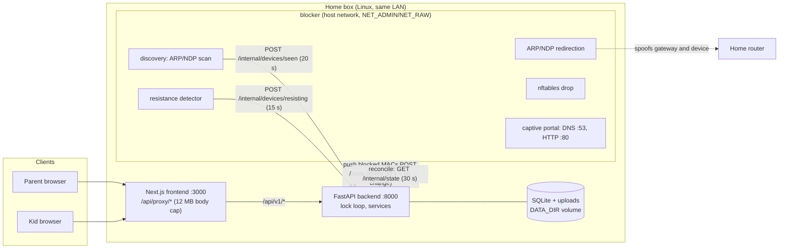
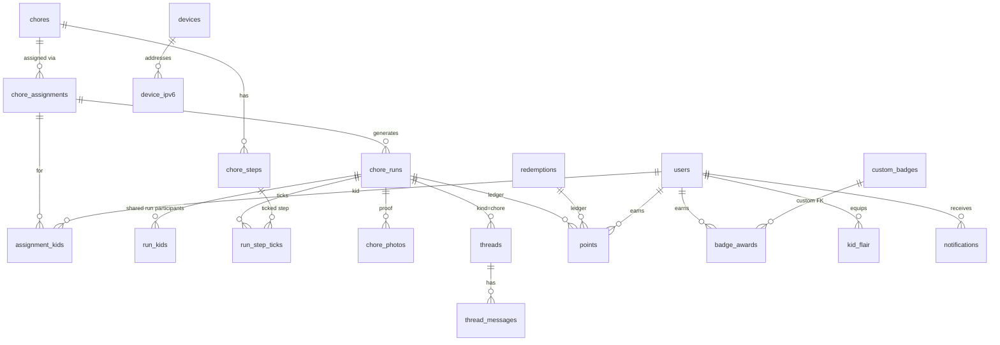

# t@sk4ce engineering overview

For contributors. Parents: start with the [guide](guide/README.md).

## Architecture

Heartbeat: the blocker's calls to `/internal/*` stamp `family_settings.blocker_last_seen`. The app calls the box offline after 90 seconds without a beat (`BLOCKER_STALE` in `backend/app/api/devices.py`) and the UI shows a banner.

Two loops decide who is blocked:

- **Lock loop** (`backend/app/lock/loop.py`, every `LOCK_INTERVAL_SECONDS`, default 30, or immediately via `trigger()`): evaluates `lock/rules.py:is_online` for every device and pushes the blocked MAC list to the blocker.
- **Reconcile** (`blocker/service.py`): the blocker also pulls `GET /internal/state` and maps blocked MACs to currently known IPv4/IPv6 addresses, then applies redirects and firewall rules. It holds no policy.

### Is a device online? (`backend/app/lock/rules.py`)

In order: a manual `lock` override blocks; guests are online; unassigned devices follow the "block new devices" setting (or a manual unlock); every owner or group with allowed hours must be inside a window; then online if all owners' chores for today are approved (or they have none), or in a free-time window, or manually unlocked, or a bonus (screen time) override is active and `points_unlock_early` is on.

## Enforcement model and limits

The box redirects a blocked device's traffic to itself with ARP (IPv4) and NDP (IPv6), spoofing both directions (the device thinks the gateway is the box, the router thinks the device is the box), drops internet-bound packets with nftables, and serves a captive portal (DNS answers with the box address; HTTP 302 to `PORTAL_REDIRECT_URL`). It fails open: if the box dies, devices return online.

Honest limits: hotspots, cellular and unregistered devices are out of scope. Routers with ARP inspection or client isolation can defeat it. A device that keeps getting traffic through is flagged `resisting`, and parents get a notification.

Reasoning, comparison with Firewalla and the lab finding behind the bidirectional design: [ADR 0001](adr/0001-blocker-enforcement-vs-firewalla.md). Operator view: [blocker.md](blocker.md). Router compatibility: [routers.md](routers.md).

## Data model

Defined in `backend/app/models/`, migrated with Alembic (`backend/alembic`). Full design and migration rules: [relational schema spec](superpowers/specs/2026-10-21-v2-relational-schema-design.md). SQLite runs with `PRAGMA foreign_keys=ON`. Closed value sets have CHECK constraints.

| Group | Tables | Notes |
|---|---|---|
| Chore library | `chores`, `chore_steps` | A chore is reusable. `archived_at` instead of delete when it has runs. |
| Who and when | `chore_assignments`, `assignment_kids` | `mode` each / race / team; `repeat` daily / weekly / once; `days` is a digit string (`"024"` = Mon, Wed, Fri). |
| Today's work | `chore_runs`, `run_kids`, `run_step_ticks` | Runs read title, points and steps live from the chore. `kid_id` NULL means a shared (race/team) run, with participants in `run_kids`. Status `todo`, `submitted`, `done`, `cancelled`; `attempt` counts send-backs. Partial unique indexes stop double generation. |
| Proof and chat | `chore_photos`, `threads`, `thread_messages`, `thread_reads`, `chat_photos` | Thread kinds `chore` (run id), `private` (kid id), `family`. |
| Economy | `points`, `rewards`, `redemptions` | `points` is the ledger: signed amount, `reason` (chore, early_bonus, team_share, redemption, bonus, adjustment), optional `run_id` or `redemption_id` (at most one). `redemptions` kind `screen_time` or `reward`, status pending / approved / denied. |
| Progression | `badge_awards`, `custom_badges`, `kid_flair` | `badge_awards` has `badge_key` (built-in) or `custom_badge_id` (FK), exactly one set. `kid_flair` PK (kid, slot). XP, levels and streaks are derived from the ledger and runs, not stored. |
| Inbox | `notifications` | One row per recipient, written with the event; nullable FKs to run, redemption, device, thread. |
| Network | `devices`, `device_ipv6`, `device_groups`, `time_windows`, `overrides` | `time_windows` kinds allowed / free, for a kid or a group. `overrides` action lock or unlock, source manual or bonus. |
| Family | `family_settings`, `users`, `used_invites` | Singleton family row: reset time, screen time price, early bonus cap, GIF settings, `blocker_last_seen`. |

Rule worth knowing: the "chore day" is computed in the family time zone (`lock/reset.py:current_chore_day`). Runs are generated at the family `reset_time`.

## Security notes

- **Auth.** JWT bearer tokens for parents and kids (`core/auth.py`). Passwords hashed; login is rate limited (`core/ratelimit.py`). Secrets (`SECRET_KEY`, `JWT_SECRET_KEY`, `INTERNAL_TOKEN`) are generated on first boot into `DATA_DIR/secrets.json` (mode 0600), overridable by env.
- **Kid login by device.** `/kid/whoami` and `/kid/login` match the requester's IP to a device and its owners. A kid can only sign in as an owner of that device, with the PIN if set. Failed tries are rate limited. The client IP comes from `X-Real-IP` only when the request comes from the trusted proxy IPs (`TRUSTED_PROXY_IPS`, the frontend's static address in compose).
- **Internal token.** `/api/v1/internal/*` requires `X-Internal-Token`, compared in constant time. The same token authenticates the app to the blocker.
- **Proxy.** The Next.js proxy (`frontend/pages/api/proxy/[...path].ts`) forwards a small header allowlist and caps request bodies at 12 MB.
- **Photos** (`services/photos.py`). Allowed types JPEG, PNG, WebP; max upload 10 MB; pixel cap 40 MP checked from the header before decoding; always re-encoded to JPEG (strips EXIF and GPS), scaled to 1600 px with a 320 px thumbnail; stored under random names and served only through authenticated endpoints.
- **GIFs.** Off by default. Chat only. Animated GIFs get 8 MB, 300 frame and total-pixel caps, are checked per frame and re-saved without metadata. GIPHY is reached only by the backend with a hard-coded host and validated ids, without redirects. The parent's key is write-only through the API. The family rating (G or PG) is re-checked server-side for every GIF id the client sends (`services/giphy.py:rating_ok`). Kids' devices never contact GIPHY.
- **Fail-open.** If the box or the blocker stops, nothing stays blocked. A failed push logs a warning and retries on the next loop.
- **Backups.** Before migrating, the entrypoint copies the SQLite file to `DATA_DIR/backups/pre-upgrade-<time>.db` when the database is not at head (`backend/entrypoint.sh`).

## Testing

| Layer | How to run | Notes |
|---|---|---|
| Backend unit and API | `cd backend && python -m pytest tests -q` | Includes migrations, integrity (every CHECK), flair CSS coverage. |
| Python style | `cd backend && ruff format --check . && ruff check .` | Same as CI lint. |
| Frontend | `cd frontend && npm test`, `npm run lint`, `npm run type-check` | Jest tests live in `frontend/tests/v2`. |
| Blocker unit | `python -m pytest blocker/tests -q` | Firewall rules, ARP, portal, identity. |
| Lab journeys | `cd blocker && RUN_INTEGRATION=1 python -m pytest tests/lab -v` | Real ARP, nftables and portal in Docker; needs Linux Docker. |
| Browser e2e | `bash scripts/lab.sh up && bash scripts/lab.sh e2e` | Playwright against the lab; screenshots in `frontend/e2e-artifacts`. |

`scripts/lab.sh` also has helper commands (`block`, `unblock`, `check`, `check6`, `portal`, `resist`, `reset`, `resisting`, `test-block`, `token`, `device-id`). Run it without arguments for the usage line. Lab details: [lab/README.md](../lab/README.md).

CI (`.github/workflows/ci-cd.yml`): `lint` (ruff, eslint, tsc), `test` (backend pytest), `lab` (journeys + browser e2e, uploads screenshots), `security-scan` (Trivy), and image build and push on `main`.

## Repository map

| Path | What is there |
|---|---|
| `backend/app/api/` | FastAPI routers: `chores`, `chore_library`, `chore_photos`, `kid`, `kids`, `family`, `devices`, `windows`, `rewards`, `badges`, `flair`, `community`, `chat`, `inbox`, `internal`, `setup`, `auth`, `users` |
| `backend/app/services/` | Business logic: `chores`, `economy`, `progression`, `badges`, `chat`, `photos`, `giphy`, `inbox` |
| `backend/app/lock/` | Rule engine, schedules, overrides, daily reset, lock loop, blocker client |
| `backend/app/models/`, `alembic/` | Tables and migrations |
| `backend/app/flair/catalog.py` | Flair catalog |
| `frontend/pages/` | Next.js routes: `/` (Today), `/devices`, `/kids`, `/settings`, `/kid`, `/chat`, `/login`, `/setup` |
| `frontend/src/v2/` | UI: `today/`, `manage/`, `kid/`, `chat/`, `setup/`, `flair/` (CSS), `components/`, `hooks/` |
| `frontend/e2e/` | Playwright specs |
| `blocker/` | Home box service: `discovery`, `arp`, `firewall`, `portal`, `resist`, `service`, `api` |
| `lab/`, `scripts/lab.sh` | Isolated Docker lab and its driver |
| `docs/` | Guide, ADRs, this file, specs and plans under `superpowers/` |

## How to add a badge

1. Open `backend/app/services/badges.py` and add a line to `CATALOG`, for example: `_d("my_badge", "My Badge", "🧹", "Short description.", "approved", 5, 10, 25, 50, 100)`. The last numbers are thresholds for copper through mega-diamond (one number means a single-tier badge).
2. The `metric` string must be one the code computes. Reuse an existing one (`approved`, `best_week`, `longest_streak`, `comebacks`, `weekend_run`, `variety`, `early`, `speed`, `clutch`, `on_time_run`, `xp`, `balance`, `redemptions`, `rewards`, `big_rewards`, `screen_redemptions`, `slots_equipped`), or add a new metric where the metrics are calculated in the same file.
3. Add a test in `backend/tests/test_badges.py` and run `python -m pytest tests/test_badges.py -q`.

Parent-made badges need no code: they are rows in `custom_badges`, created in Kids & chores → Badges.

## How to add a flair item

1. Open `backend/app/flair/catalog.py`. Add to `CATALOG` with the `_i(level, slot, ...)` helper, for example `*_i(12, "ring", "Teal")` (id `ring-teal`, unlocks at level 12). Slots: `card`, `ring`, `name`, `emblem`, `title`. For an emblem use `("suffix", "Name|emoji")`.
2. Non-emblem items need CSS for `.flair-<id>`, in the matching file under `frontend/src/v2/flair/`: `cards.css`, `rings.css`, `names.css` or `titles.css`. Emblems are just emoji and need no CSS.
3. Any animation must be inside `@media (prefers-reduced-motion: no-preference)`.
4. Run `cd backend && python -m pytest tests/test_flair.py tests/test_flair_css.py -q`. The CSS test fails if an item has no CSS or an animation is outside the motion guard.
