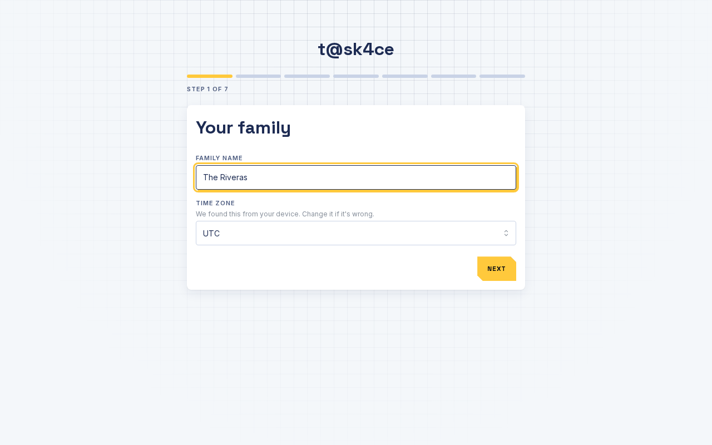
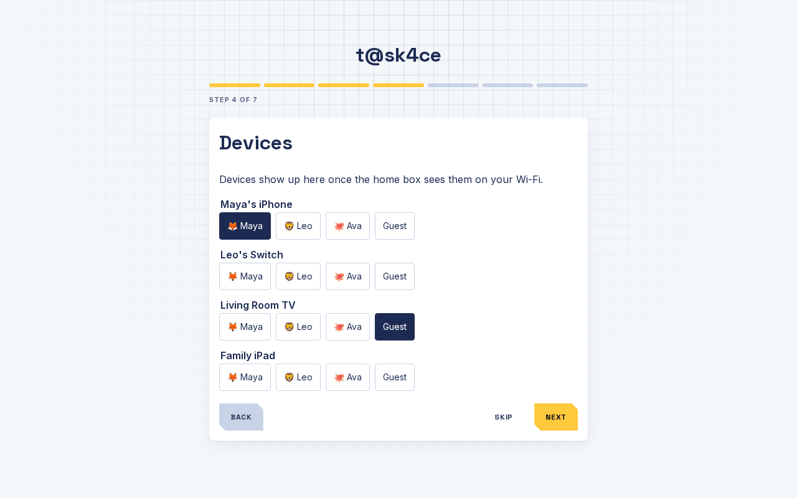
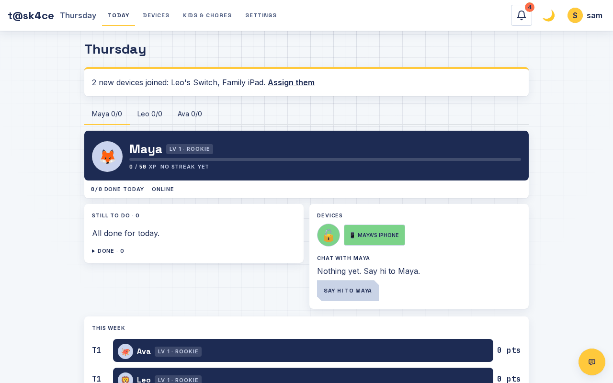

# 3. First-time setup

When you open t@sk4ce for the first time, a short wizard asks a few questions. It has seven steps. You can change every answer later.

## Step 1. Your family

Type your family name. Check the time zone. The app guesses it from your device, so it is usually right.

Tap **Next**.

You should see: step 2, "Your account".

## Step 2. Your account

Type your name, a username and a password (at least 8 characters). This is your parent login. Write the password down somewhere safe.

Tap **Next**.

You should see: step 3, "Add kids".

## Step 3. Add kids

For each kid: type their name, pick an avatar, and optionally set a 4-digit PIN. A PIN helps when siblings share a device. Tap **Add kid**. Add everyone, then tap **Next**.

You should see: your kids listed under "Kids added".

## Step 4. Devices

Devices show up here once the home box sees them on your Wi-Fi. This can take a minute or two. Ask each kid to turn on their phone, tablet or console Wi-Fi.

For each device, tap the kid who owns it. Tap **Guest** for devices that should always be online, like a visitor's phone or the family TV.

You should see: each device shows the kid's name highlighted. Devices you skip stay in a "New" list, and you can finish later on the **Devices** page.

If no devices appear after a few minutes, skip this step and see [Troubleshooting](06-troubleshooting.md).

## Step 5. Chores

Tick any starter chores you like. They are only suggestions. You will add your own after setup.

You should see: ticked chores in the list.

## Step 6. Bedtime

Tick **Add bedtime** if you want the internet on only from 7:00 am to 9:00 pm for each kid. You can change the hours later in Settings.

You should see: the box ticked.

## Step 7. Remote access

This step explains how to check in from outside the house. It is optional. Tap **Finish**.

You should see: the **Today** screen with a tab for each kid.

## Test that pausing works

Do this once. It takes two minutes.

1. Tap **Devices** at the top.
2. Tap a kid's device to open it.
3. Tap **Test block**.

You should see: a message such as "Success: the device lost internet access while blocked."

If you see something else, read the message. It tells you what to try. The other messages are explained in [the home box notes](../blocker.md) and in [Troubleshooting](06-troubleshooting.md).

Make sure the device is awake and online before you press the button. Open a video on it if the test says it didn't see the device use the internet.

## Show your kids

Open the kid's device. Use its browser to go to the same address you used (for example `http://192.168.1.50:3000/kid`) and bookmark it. Then show them [the kids' page](05-for-kids.md).

Next: [Everyday use](04-everyday-use.md).
