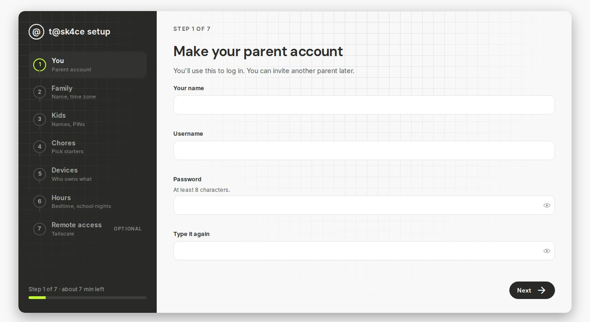
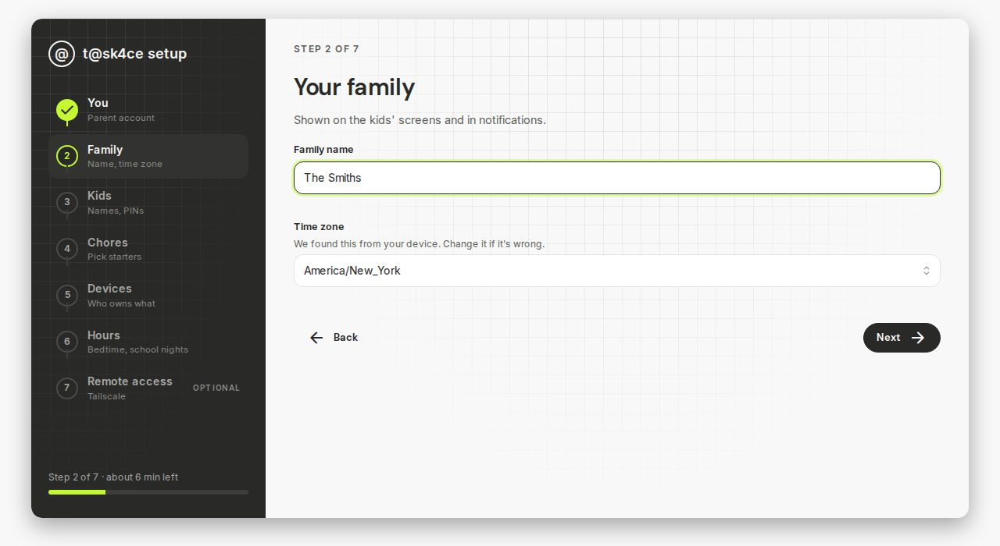
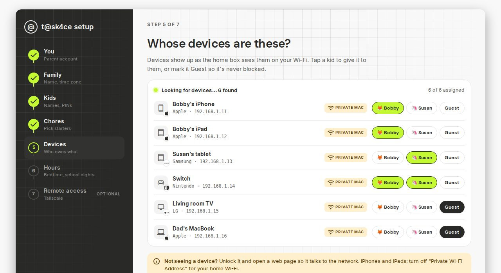
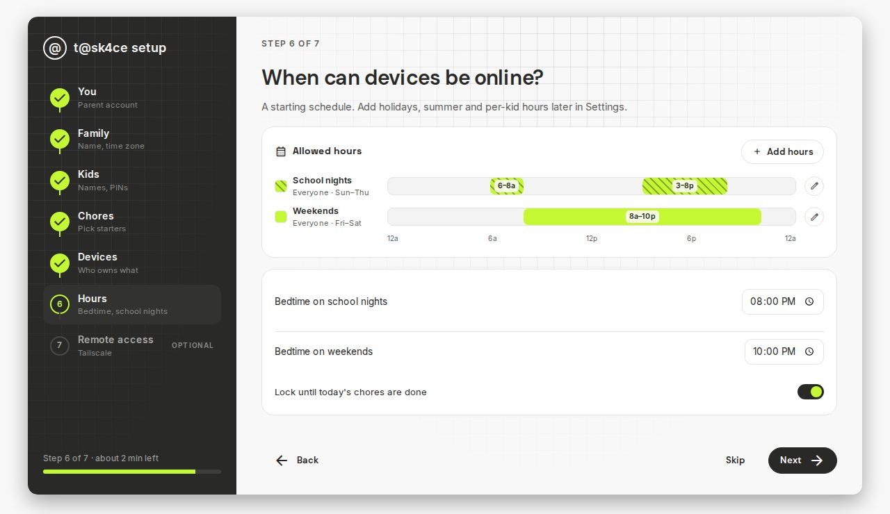
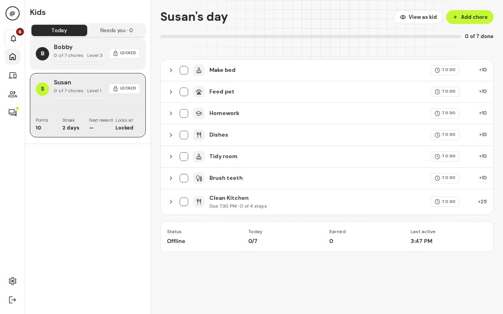

# 3. First-time setup

"Open t@sk4ce" means: in a web browser on your phone or computer, type the address from the install step (like `http://192.168.1.50:3000`) into the address bar. Not working? See [Troubleshooting](06-troubleshooting.md).

The first time you open t@sk4ce, a short wizard asks a few questions. It has seven steps: **You**, **Family**, **Kids**, **Chores**, **Devices**, **Hours** and **Remote access**. The last one is optional. It takes about 7 minutes, and you can change every answer later.

If you stop partway, just open t@sk4ce again and log in. It picks up where you left off.

## Step 1. You

The page says "Make your parent account". Type your name, a username and a password (at least 8 characters), then type the password again. This is your parent login. Write the password down somewhere safe.

Tap **Next**.

You should see: step 2, "Your family".

## Step 2. Family

Type your family name. Kids see it on their screens. Check the time zone. The app guesses it from your device, so it is usually right.

Tap **Next**. This makes your account and logs you in.

You should see: step 3, "Add your kids".

## Step 3. Kids

For each kid: type their name, pick an avatar, and optionally set a 4-digit PIN. A PIN lets a kid prove it's them on a shared device. Tap **Add kid**. Add everyone, then tap **Next**.

You should see: each kid in the list, marked "Added".

Every kid starts with the **Kid (9–12)** look. You can switch a kid to **Little (5–8)** or **Teen (13+)** later, in **Kids & chores**. See [For kids](05-for-kids.md).

## Step 4. Chores

Tap the starter chores you like, such as **Make bed**, **Homework** or **Feed the pet**. Each one becomes a daily chore for every kid you added, with points. They are only a start. You can change them later.

You should see: a tick on each chore you picked, and "4 picked" (or however many) next to **Next**.

## Step 5. Devices

The page asks "Whose devices are these?" Devices show up here once the home box sees them on your Wi-Fi. This can take a minute or two. Ask each kid to unlock their phone, tablet or console and open a web page.

For each device, tap the kid who owns it. A shared device can have more than one owner. Tap **Guest** for devices that should never be blocked, like a visitor's phone or the family TV.

You should see: the kid's name highlighted on each device. Devices you skip wait under **Who's this?** on the **Devices** page, and you can finish there later.

Not seeing a device? iPhones and iPads use a "Private Wi-Fi Address". Turn it off for your home Wi-Fi in the device's Wi-Fi settings. If nothing shows up after a few minutes, skip this step and see [Troubleshooting](06-troubleshooting.md).

## Step 6. Hours

The page asks "When can devices be online?" It starts you with two schedules for everyone:

- **School nights** (Sunday to Thursday): 6 to 8 am and 3 to 8 pm.
- **Weekends** (Friday and Saturday): 8 am to 10 pm.

Change the bedtimes if you like. Tap the pencil on a row to change it, or **Add hours** for more.

**Lock until today's chores are done** is on. That means devices stay paused, even inside these hours, until the day's chores are approved. Turn it off if you only want the schedule.

You should see: the hours as bars on the timeline.

## Step 7. Remote access (optional)

This step explains how to check in from outside the house with Tailscale, a free app. You can do it later: the full steps are in [Remote access](../remote-access.md). Tap **Finish**.

You should see: "You're all set", with how many kids, chores, devices and schedules you made. Tap **Go to Today**.

On a computer, Today shows a card for each kid on the left and the chosen kid's day on the right. On a phone, the kids are a row of avatars at the top.

## Test that pausing works

Do this once. It takes two minutes.

1. Tap **Devices**. On a phone it is in the bar at the bottom. On a computer it is in the bar on the left.
2. Tap a kid's device to open it.
3. Tap **Test block**.

You should see: a message such as "Success — the device lost internet access while blocked."

If you see something else, read the message. It tells you what to try. The other messages are explained in [the home box notes](../blocker.md) and in [Troubleshooting](06-troubleshooting.md).

Make sure the device is awake and online before you press the button. Open a video on it if the test says it didn't see the device use the internet.

## Show your kids

Open the kid's device. Use its browser to go to the same address with `/kid` on the end (for example `http://192.168.1.50:3000/kid`) and bookmark it. Then show them [the kids' page](05-for-kids.md).

Next: [Everyday use](04-everyday-use.md).
