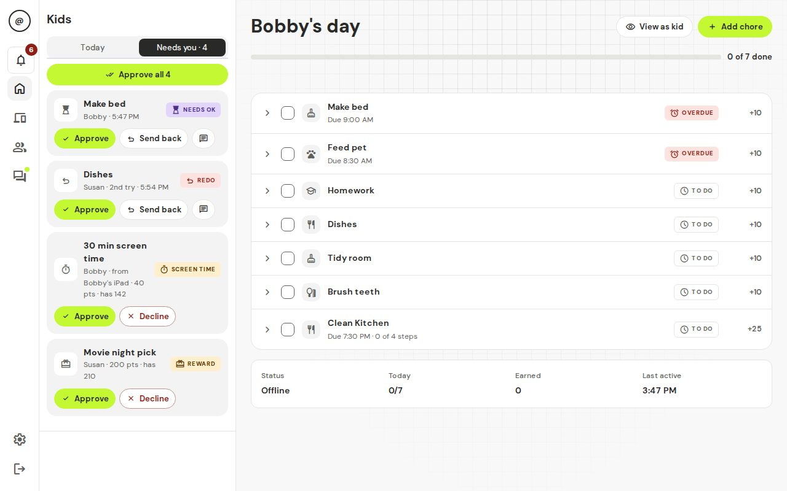

# 4. Everyday use

## Finding your way

- **On a phone**, a bar at the bottom has **Today**, **Devices**, **Kids**, **Chat** and **More**. The bell and your initial are at the top right. **More** holds **Settings**, the notifications page and **Help & guide**.
- **On a computer**, a bar on the left has the bell, **Today**, **Devices**, **Kids & chores** and **Chat**. **Settings** and **Log out** are at the bottom of the bar.

A dot on **Chat** means there are unread messages.

## Today

This is the page you will use most.

Pick a kid to see their day: how many chores are done, their points, streak, next reward and when their devices lock. Each chore has a chip: **To do**, **Overdue**, **Needs OK**, **Redo**, **Approved** or **Skipped**. Tap a chore to open it. There you can approve it, send it back, mark it done yourself, open its chat or take points away (**Deduct points**).

**View as kid** shows you exactly what that kid sees. **Add chore** makes a new chore for them.

## Needs you

**Needs you** is the list of everything waiting for your decision, from all kids. On a phone it is the second tab at the top of Today. On a computer it is the second tab above the kid cards.

- **Needs OK**: a kid says a chore is done.
- **Redo**: a chore you sent back, done again ("2nd try").
- **Screen time**: a kid asks to spend points on extra minutes.
- **Reward**: a kid asks to cash in points for a reward.
- **Note**: a kid tapped **Tell Mom or Dad** on a chore, for example "Need help". Tap **Reply** to answer in the chore's chat.

When more than one thing is waiting, **Approve all** approves them in one go.

### Approve a chore or send it back

1. Find the chore in **Needs you**. If the kid added a photo, tap it to see it larger.
2. Tap **Approve**, or tap **Send back**.
3. If you send it back, type a short note, like "The sink still has dishes." You can't send it back without a note.

You should see: for Approve, the item disappears and the kid gets their points (and the internet, if that was their last chore). For Send back, the kid sees your note and does the chore again.

Points come to the kid when you approve, not before. If a kid finishes early, they can earn a small bonus. You choose the limit in **Settings → Family**.

### Answer a screen time or reward request

Tap **Approve** or **Decline**. The points are only taken when you approve. A declined or ignored request costs nothing.

You should see: the item leaves the list. The kid is told what you decided.

## The bell

The bell shows what happened: chores to approve, kid notes, requests, new devices, badges and level-ups, and security alerts such as a device that "got around the lock". Use the **All**, **Needs you** and **Alerts** tabs to filter. You can approve or send back right from the bell. Tap an item to go straight to it. **Mark all read** clears the count.

On a phone the bell opens as a sheet from the bottom of the screen.

## Kids & chores

**Kids & chores** (just **Kids** on a phone) has four tabs: **Chores**, **Kids**, **Rewards** and **Badges**.

### Make a chore once, use it many times

1. Tap **Kids & chores**, then **Chores**, then **New chore**.
2. Type a **Chore name** and the number of **Points**. Pick a type, like Kitchen or Schoolwork.
3. Add **steps** if you like (for example "Rinse", "Load", "Wipe"). Each step can have its own due time. Tap **Any order** under a step to make it **Must be done after the step above**. The kid can't say a chore is done until every step is ticked.
4. Turn on **Needs a photo** if the kid must show proof.
5. Tap **Save chore**.

You should see: "Added. Now choose who does it."

Now, under **Who & when**:

1. Pick who does it (one or more kids).
2. If you picked several kids, choose how it works:
   - **Each does it**: every kid gets their own copy and their own points.
   - **First one wins**: one chore for everyone. The first kid to finish it gets the points.
   - **Team effort**: one chore for everyone. Any kid can tick it, and the points are split evenly.
3. Choose **Repeat**: **Every day**, **Some days** (pick the days) or **One time** (pick the date).
4. Optionally set **Due by**.
5. Tap **Save chore**.

You should see: the chore in the list with the kids' avatars. It appears on Today at your daily reset time (6:00 am unless you changed it in **Settings → Family**).

If you change a chore's name, points or steps, the change shows up everywhere, including today's chores that aren't done yet. **Duplicate** makes a new chore from an old one, handy for "same chore, different points". **Delete** removes it from the list but keeps the history of what was done.

### Kids

Open a kid to see their devices, chores and points history. The buttons at the top:

- **View as kid**: see their screen.
- **Bonus**: give 1 to 500 points with a short note. They get a celebration.
- **Deduct**: take points away, with a reason the kid can see.
- **Edit**: change their name, avatar, PIN or **Age group** (Little, Kid or Teen).

## Rewards and screen time

Open **Kids & chores → Rewards**. It has four parts:

- **Requests**: what kids are asking for.
- **Catalogue**: tap **New reward** for things kids can save up for, with a price in points and an icon. Turn off **Needs approval** if a kid can just take it (the points come off right away and you get a ping). Turn off **Kids can see it** to hide it for now.
- **Screen time**: lets kids spend points on extra internet time. It is off until you turn on **Kids can buy extra minutes**. The price starts at 20 points for 15 minutes. You can also set a **Max per day**, **Approve automatically** and **Only during allowed hours**. Bought minutes never work during off hours like bedtime.
- **History**: the last 30 days.

A kid sees a progress bar toward each reward and can ask when they have enough.

## Points, levels and badges

- Approved chores earn **points**. Kids spend points on rewards and screen time.
- Lifetime points give **levels**. Spending never lowers a level. The titles go from Rookie up to Mythic.
- **Badges** come automatically (like First Blood for a first approved chore, and On Fire for a streak). They get better in tiers: copper, silver, gold, platinum and mega-diamond.
- A **streak** counts days in a row when every chore was done and approved. Days with no chores do not break it.
- Higher levels unlock flair that kids wear on their name card. See [For kids](05-for-kids.md).
- Kids can see a weekly **leaderboard** of points earned that week. Spending does not count, and it starts again each week.

In **Kids & chores → Badges** you see who has what (**All badges**), what was won lately (**Recent awards**), and **Custom badges**: make your own ("Did the dishes without being asked") and give them by hand. Each time you give the same badge, it moves up a tier.

## Devices

**Devices** lists every device the box has seen, grouped by owner: **Who's this?** (new devices), one group for each kid, **Shared**, **Guests** and **No owner**. New devices stay paused until you give them an owner. You can change that in **Settings → Family** (**Block new devices until I assign them**).

Tap a device to open it:

- **Lock now** pauses it until you change it. **Unlock 30 min** lets it online for half an hour. **Back to schedule** cancels either one.
- **Test block** checks that pausing works for this device.
- **Guest (never blocked)** keeps it online always.
- **Always allowed (never lock)** skips hours and the chore check for this one device, like a kid's laptop for school. A manual lock still works.
- **Network** and **Activity** show its addresses, when it was online and any alerts.

The **Groups** tab puts several devices together, like "Game consoles", so you can lock them all at once.

If the home box stops checking in, a red **Home box offline** message appears at the top. See [Troubleshooting](06-troubleshooting.md).

## Hours

**Settings → Hours** sets when devices may be online. Outside these hours, they lock. Each rule has a kind:

- **School nights** and **Weekends**: your everyday hours.
- **Holiday** and **Summer**: these replace everyday hours between the dates you pick. Tap **Add holiday**.
- **Other**: anything else. Tap **Add window**.

Each rule says what it does: **Online**, **Free time** (online even if chores aren't done, like Saturday morning) or **Internet off** (like bedtime). A rule can be for **Everyone**, or for chosen kids or device groups. The timeline shows the whole family's week.

**Lock until today's chores are done** turns the chore check on or off for the whole family.

## Chat

Tap **Chat** to see every conversation:

- **Chore threads**: every chore has one. Proof photos, kid notes and your send-back notes show up there. Anyone can add text or photos.
- **Private**: one chat for each kid with the parents. Other kids can't see it.
- **Family**: everyone together.

Use **Chores**, **Notes** and **Family** at the top to filter. Quick replies like "Looks good" save typing. When you open a chore's chat from Today or Needs you, it opens in a panel on a computer, or as a sheet from the bottom on a phone.

### GIFs (off by default)

You can allow GIFs in chat. It's off until you turn it on.

1. Make a free key at https://developers.giphy.com/ (a GIPHY account is needed).
2. In **Settings → GIFs**, turn on **Allow GIFs in chat**.
3. Paste your key into **GIPHY key**.
4. Pick a **GIF rating**, **G (all ages)** or **PG**.

You should see: a GIF button in chat.

**Privacy note.** When someone searches for a GIF, the search words go to GIPHY through your home box. Kids' devices never talk to GIPHY directly. GIPHY will see your key and the search, but not the kid's device. The rating is checked again on the box before a GIF is sent. Leave GIFs off if you don't want this.

## Notifications

### Pings in your own chat apps

t@sk4ce can send pings to the apps your family already uses, like a Signal group, a Discord channel or email. It uses Apprise, which works with most chat apps and email.

1. Open **Settings → Notifications** and tap **Add a place**.
2. Give it a **Name** and paste an **Apprise address** (the Apprise website lists the format for each app).
3. Choose which events it gets, then tap **Test**.

You should see: a test message in that app.

During **Quiet hours** other pings wait: chores to approve, notes, requests and new devices are sent together when quiet hours end. Security alerts (a device getting around the lock, the box going offline) still send unless you turn off **Security alerts still send**. Set **App address** to the address you open t@sk4ce with, so the link in each ping works.

These pings leave your home: they go to the service you chose.

### Alerts on a kid's phone

**Settings → Notifications** also shows a code for each kid. Install the free **ntfy** app on the kid's phone and scan the code with the phone's camera. Alerts then arrive even when t@sk4ce is closed: a chore due soon, approved or sent back, points taken, new chores, messages, a badge or level-up, and a warning in the 10 minutes before the internet goes off. **New code** makes a fresh code; the old one stops working.

iPhones get these alerts late unless you turn on **Instant alerts on iPhones**. That asks the public ntfy.sh service to wake the phone. Only a wake-up goes out; the alert text stays in your home.

**Who can read them.** The box's ntfy service (port 2586) has no password, by design. Anyone on your home Wi‑Fi who knows a kid's topic name can read that kid's alerts. The topic is a long random name that works like a password, so keep it secret: only share it by scanning the code. Alerts say things like "Dishes is due soon", never passwords.

**Want a password on it?** Use ntfy's own access control. In `docker-compose.prod.yml`, add to the `ntfy` service's `environment`:

    NTFY_AUTH_FILE: /var/cache/ntfy/user.db
    NTFY_AUTH_DEFAULT_ACCESS: write-only

Then `docker compose -f docker-compose.prod.yml up -d ntfy`, and on the box run `docker compose -f docker-compose.prod.yml exec ntfy ntfy user add pat` and `... exec ntfy ntfy access pat <topic> read-only` for each kid. In the ntfy app, add the box's server with that user's name and password. `write-only` keeps the box able to send without a password; reading needs a login. Details: [ntfy access control](https://docs.ntfy.sh/config/#access-control).

## Add another parent

**Settings → Parents → Invite a parent** makes a link for a partner or grandparent. It works once and lasts 24 hours. Every parent can approve chores, lock devices and change settings.

Next: [For kids](05-for-kids.md).
