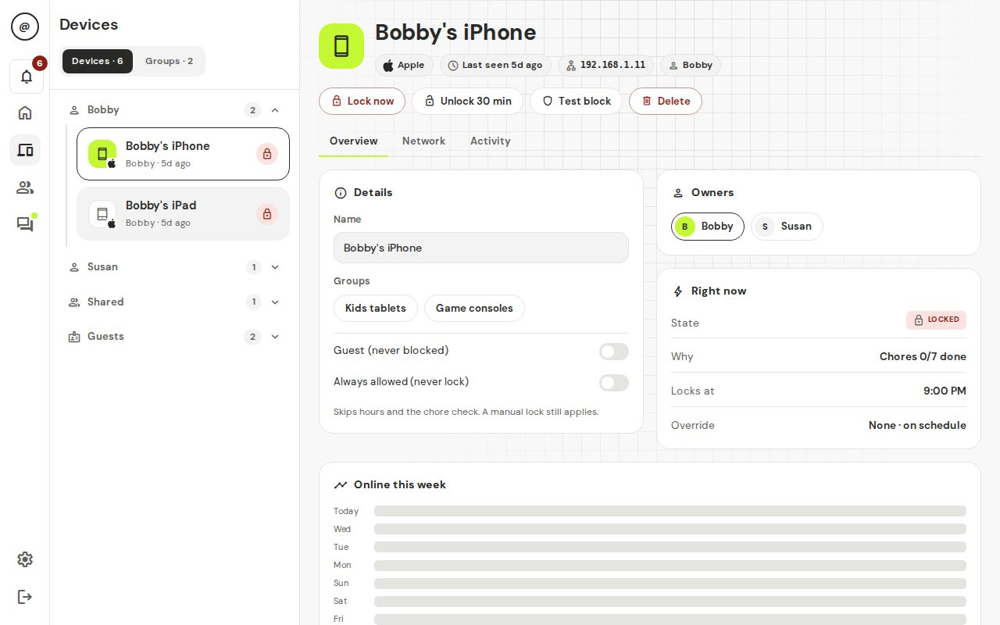
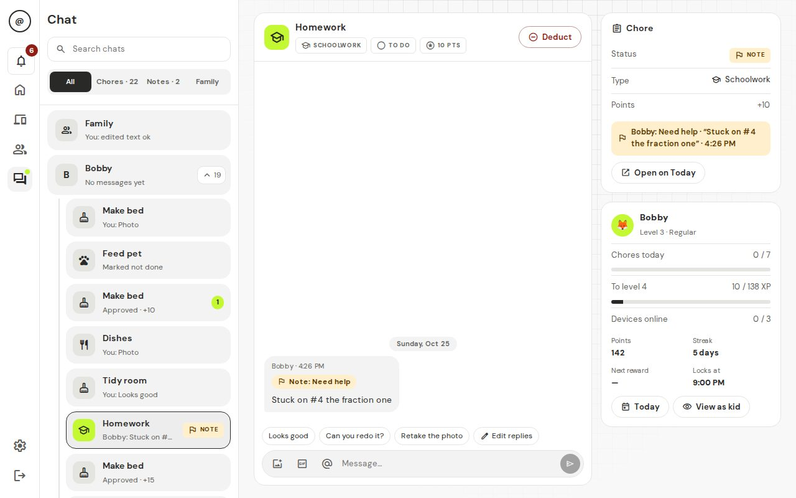

# 4. Everyday use

The top bar has four places: **Today**, **Devices**, **Kids & chores** and **Settings**. There is also a bell for notifications and a chat button. Tap your name at the right end of the bar to open **Help**, **Settings** and **Log out**.

## Today

This is the page you will use most.

**Needs you** is at the top. It lists everything waiting for a decision, from all kids:

- **Chore**: a kid says it is done.
- **Redo**: a chore you sent back, done again ("2nd try").
- **Screen time**: a kid asks to spend points on extra minutes.
- **Reward**: a kid asks to cash in points for a reward.

Use the filter chips to show only one kind. Tap **Approve all** to approve every chore in view.

Below that is one tab for each kid. A red dot means that kid has something waiting for you. Each tab shows their level, points, streak, what they still have to do, what is done, their devices and recent activity. **Chat with** shows the latest message from that kid, or **Say hi** if nobody has written yet.

### Approve a chore or send it back

1. Tap an item in **Needs you**. If the kid added a photo, tap it to see it larger.
2. Tap **Approve**, or tap **Send back**.
3. If you send it back, type a short note, like "The sink still has dishes." The note is required.

You should see: for Approve, the item disappears and the kid gets their points (and the internet, if this was their last chore). For Send back, the kid sees your note and does the chore again.

Points come to the kid when you approve, not before. If a kid finishes early, they can earn a bonus (you choose the limit in Settings).

### Answer a screen time or reward request

Tap **Approve** or **Deny**. The points are only taken when you approve. A denied or ignored request costs nothing.

You should see: the item leaves the list. The kid is told what you decided.

## Kids & chores

### Make a chore once, use it many times

1. Tap **Kids & chores**, then **Chores**, then **New chore**.
2. Type a **name** and the number of **points**.
3. Add **steps** if you like (for example "Rinse", "Load", "Wipe"). The kid ticks each step, and cannot say "done" until every step is ticked.
4. Tick **Needs a photo** if the kid must show proof.
5. Tap **Save**.

You should see: the chore in the list.

Now give it to your kids. In the chore, tap to add an assignment:

1. Pick **who** (one or more kids).
2. If you picked several kids, choose how it works:
   - **Each**: every kid gets their own copy and their own points.
   - **Race**: one chore for everyone. The first kid to get it approved gets the points.
   - **Team**: one chore for everyone. Any kid can tick steps. The points are split evenly.
3. Choose when it repeats: **Every day**, **Some days** (pick the days) or **One time** (pick the date).
4. Optionally set a **due time**.
5. Tap **Save**.

You should see: the chore listed with the kids' avatars. It appears in Today at your daily reset time (6:00 am unless you changed it).

You can use one chore many times. For a one-time job like "clean the garage", keep it in the list and give it a new date later. If you change a chore's name, points or steps, the change shows up everywhere, including today's chores that aren't done yet. History is kept.

**Copy** makes a new chore from an old one, handy for "same chore, different points". **Delete** removes it from the list but keeps the history of what was done.

### Kids, rewards and badges

In **Kids & chores** you also find:

- **Kids**: change a name, avatar or PIN, or add another kid. Open a kid and tap **Give bonus points** to give 1 to 500 points with a short note. They get a celebration.
- **Rewards**: tap **New reward** to create things kids can save up for, with a point price and optional picture.
- **Badges**: tap **New badge** to create your own badges ("Did the dishes without being asked") and give them by hand. Each time you give the same badge, it moves up a level.

## Points, levels and badges

- Approved chores earn **points**. Kids spend points on rewards and screen time.
- Lifetime points give **levels**. Spending never lowers a level. The titles go from Rookie up to Mythic.
- **Badges** come automatically (like First Blood for a first approved chore, and On Fire for a streak). They get better in tiers, from copper to mega-diamond.
- A **streak** counts days in a row when every chore was done and approved. Days with no chores do not break it.
- In the **Locker**, kids unlock and wear flair: card styles, rings, name colors, emblems and title tags. It is just for fun, and any kid can wear anything they've unlocked.
- The **leaderboard** is a weekly ranking by points earned that week. Spending does not count. It starts again each week. Kids can see each other's levels and flair.

## Screen time and rewards

Kids can ask to spend points on extra internet time. You set the price in **Settings → Screen time & bonuses**. The default is 20 points for 15 minutes. You can also turn this off. When you approve, the points are taken and the kid's devices are online for that time.

Rewards are the things you create yourself. A kid sees a progress bar toward each one and can ask when they have enough.

## Devices and hours

On **Devices**, three lists:

- **New**: devices the box just noticed. Pick an owner or mark as guest. New devices are paused until you do (you can change that in Settings).
- **Assigned**: a device with one or more kid owners. It is paused until all its owners' chores are approved.
- **Guests**: always online.

Tap a device to rename it, change owners, **Lock options** or **Test block**. Lock options let you pause or unpause a device for 30 minutes, an hour, or until you change it. **Groups** let you put several devices together, like "TVs".

In **Settings → Hours** you set, for each kid or group:

- **Allowed hours**: the times they can be online at all (like 7:00 am to 9:00 pm). Outside these hours the device is always paused.
- **Free time**: times when the internet is on even if chores aren't done (like Saturday morning).

A banner at the top of the page appears if the **home box is offline**. See [Troubleshooting](06-troubleshooting.md).

## Chat

The chat button opens a small dock at the bottom of the page.

- **Chore threads**: every chore has a thread. Proof photos and your send-back notes show up there. Anyone can add text or photos.
- **Private**: one chat for each kid with the parents. Other kids can't see it.
- **Family**: everyone together.

Unread counts show on the kid's tab and in the chat list.

### GIFs (off by default)

You can allow GIFs in chat. It's off until you turn it on.

1. Make a free key at https://developers.giphy.com/ (a GIPHY account is needed).
2. In **Settings → GIFs in chat**, turn on **Allow GIFs in chat**.
3. Paste your key into **GIPHY key**.
4. Pick a rating, **G** or **PG**.

You should see: a GIF button in chat.

**Privacy note.** When someone searches for a GIF, the search words go to GIPHY through your home box. Kids' devices never talk to GIPHY directly. GIPHY will see your key and the search, but not the kid's device. The rating is checked again on the box before a GIF is sent. Leave GIFs off if you don't want this.

## Notifications

The bell shows what happened: a chore to approve, a request, a new device, a kid's badge or level up, and if a paused device is "getting around the block". Tap an item to go straight to it. **Mark all read** clears the list.

### Alerts on a kid's phone

**Settings → Notifications** shows a code for each kid. Install the free ntfy app on the kid's phone and scan the code; alerts then arrive even when t@sk4ce is closed.

**Who can read them.** The box's ntfy service (port 2586) has no password, by design. Anyone on your home Wi‑Fi who knows a kid's topic name can read that kid's alerts. The topic is a long random name that works like a password, so keep it secret: only share it by scanning the code, and never pick your own short topic name. Alerts say things like "Dishes is due soon", never passwords.

**Want a password on it?** Use ntfy's own access control. In `docker-compose.prod.yml`, add to the `ntfy` service's `environment`:

    NTFY_AUTH_FILE: /var/cache/ntfy/user.db
    NTFY_AUTH_DEFAULT_ACCESS: write-only

Then `docker compose -f docker-compose.prod.yml up -d ntfy`, and on the box run `docker compose -f docker-compose.prod.yml exec ntfy ntfy user add pat` and `... exec ntfy ntfy access pat <topic> read-only` for each kid. In the ntfy app, add the box's server with that user's name and password. `write-only` keeps the box able to send without a password; reading needs a login. Details: [ntfy access control](https://docs.ntfy.sh/config/#access-control).

## Add another parent

**Settings → Parents** makes an invite link for a partner or grandparent.

Next: [For kids](05-for-kids.md).
