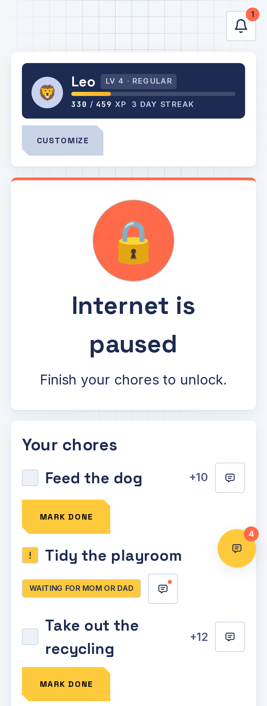
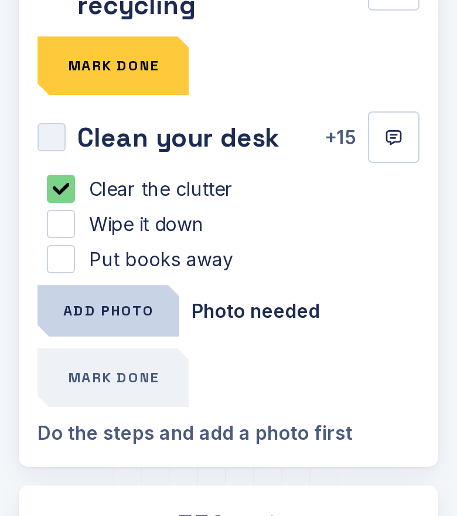
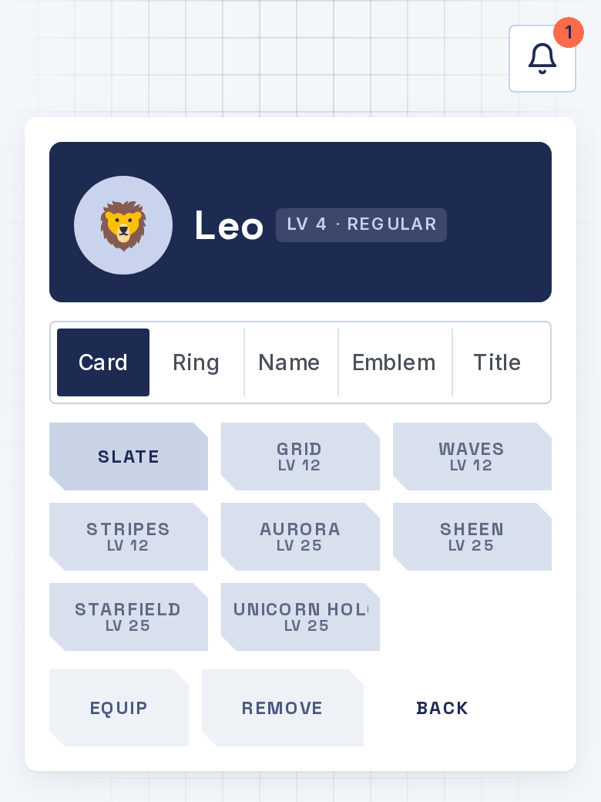

# For kids

Show this page to your kid. It's short.

## How it works

1. You have chores. Open t@sk4ce and see them.
2. Do the chore. Tick each step if it has steps.
3. Add a photo if it asks for one. **Mark done** stays grey and tells you what is missing (like "Add a photo first") until you are ready.
4. Tap **Mark done**.
5. A parent checks it. When they approve, you get points. When all your chores are approved, your internet comes on.

If a parent sends a chore back, read the note and try again. It's not a punishment. It means "almost".

## Opening t@sk4ce

Your parent will give you a web address, or put a bookmark on your device. Open it. The app knows which device you are on and shows your name. Tap it. If you have a PIN, type it.

## Chores

- **Each** chores are only yours.
- **Race** chores go to the first person who gets them approved. Be quick.
- **Team** chores are shared. Anyone can tick steps, and the points are split.

## Points, levels and badges

Points are for spending. Levels only go up and show how much you've done in all. Streaks count days in a row with all your chores done. Badges pop up when you reach a goal.

## The Locker

Tap **Customize** to open the Locker and dress up your name: cards, rings, name colors, emblems and titles. Higher levels unlock more. Items you haven't unlocked show the level you need.

## Spending points

Look for **Rewards**. Ask for screen time (you pick the minutes), or save up for a reward and ask when the bar is full. A parent has to say yes. If they say no, you keep your points.

## Chat

Tap the small speech bubble next to a chore to talk about it. A dot on it means there is a new message. You can also use the chat button to message your parents, or talk to the whole family. Be kind. Parents can read the chats you are in.

## Good to know

- Your parents can see your devices and when they're online.
- If your internet is paused, opening a website may take you to t@sk4ce so you can see what is left.
- Using a hotspot or someone else's device to dodge the pause is not the game. The app tells your parents when it notices, so talk to them instead.
