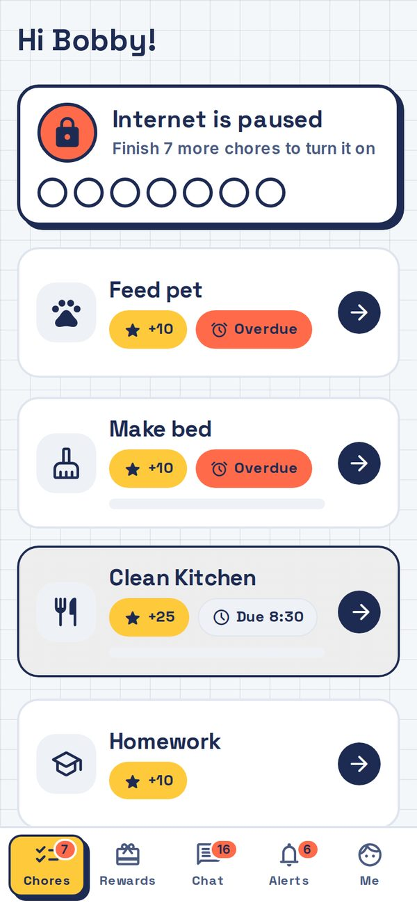
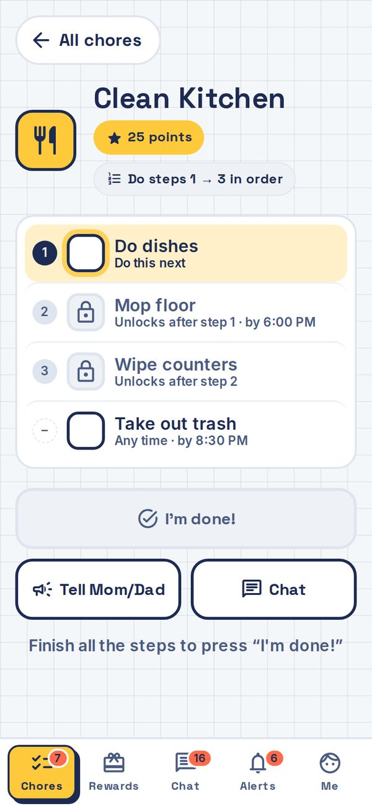
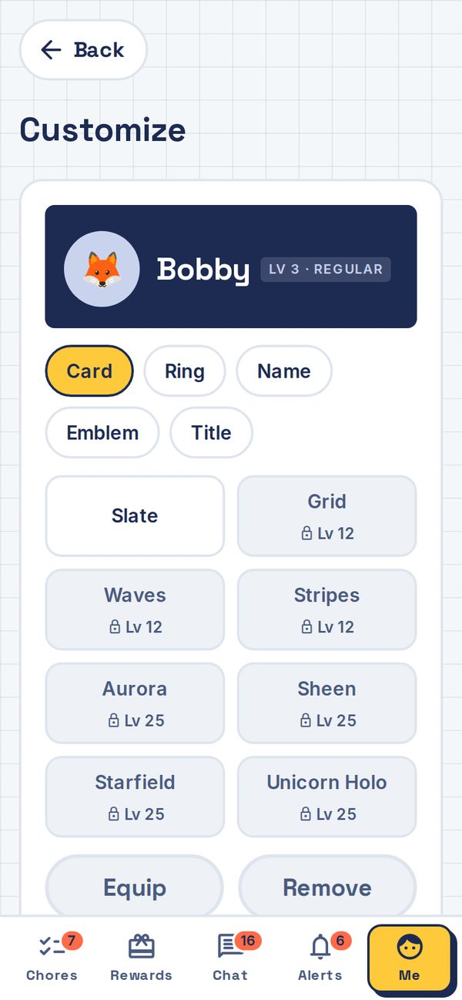

# 5. For kids

Show this page to your kid. It's short.

## How it works

1. You have chores. Open t@sk4ce and see them.
2. Do the chore. Tick each step if it has steps. Some steps have a lock: they open once the step above is done.
3. Add a photo if it asks for one.
4. Tap **I'm done!** It stays grey and tells you what is missing (like "Add a photo first") until you are ready.
5. A parent checks it. When they approve, you get points. When all your chores are approved, your internet comes on.

If a parent sends a chore back, read the note and try again. It's not a punishment. It means "almost".

## Opening t@sk4ce

Your parent will give you a web address, or put a bookmark on your device. Open it. The app knows which device you are on. If more than one kid uses it, it asks "Who is this?": tap your name. If you have a PIN, type it.

On a shared device, tap **Me**, then **Not me** when you are finished, so the next person can sign in.

## Your screen

Your parent picks the look that fits your age. All three work the same way.

- **Little (5–8)**: one big "Do this now" card at a time, with stars for chores done and a big **I did it!** button. "No games yet" turns into "Games on!" when you're done. Tabs: **Chores**, **Prizes** and **Me**.
- **Kid (9–12)**: a banner that says if your internet is on, and a big tile for each chore. Open one to see its steps and tap **I'm done!**. Tabs: **Chores**, **Rewards**, **Chat**, **Alerts** and **Me**.
- **Teen (13+)**: a list you can filter (**All**, **To do**, **Waiting**, **Done**), with the chore details beside it and a **Mark done** button. Same tabs as Kid.

## Chores with others

Some chores are shared with a brother or sister:

- **Each does it**: you each have your own copy.
- **First one wins**: the first to finish gets the points. If someone beat you to it, it says "Taken by" and their name.
- **Team effort**: anyone can tick the steps, and the points are split.

## Tell Mom or Dad

Stuck? On a chore, tap **Tell Mom/Dad** (the hand button in Little). Pick a note, like "Need help", "Ran out of time" or "Can't do it today", add a few words if you like, and send it. Your parent sees it straight away.

## Points, levels and badges

Points are for spending. Levels only go up and show how much you've done in all. Streaks count days in a row with all your chores done. Badges pop up when you reach a goal, and get better from copper up to mega-diamond.

## Customize

Tap **Me**, then **Customize**, to dress up your name card. Pick what to change, **Card**, **Ring**, **Name**, **Emblem** or **Title**, then pick an item and tap **Equip**. Higher levels unlock more. Items you haven't unlocked show the level you need, like "Lv 6".

## Spending points

Tap **Rewards** (**Prizes** in Little). Ask for screen time (you pick the minutes), or save up for a reward and tap **Request** when the bar is full. Some rewards say **Get it**: those don't need a yes. Otherwise a parent has to say yes. If they say no, you keep your points.

## Chat and alerts

In **Chat** you can talk to your parents (just you and them), to the whole family, or about a chore. Be kind. Parents can read the chats you are in.

**Alerts** tells you when a chore is due soon, when a parent approved or sent something back, and when the internet is about to go off. Your parent can also set up your phone to get these alerts, by scanning a code in the free ntfy app.

Little mode has no chat or alerts tab.

## Good to know

- Your parents can see your devices and when they're online.
- If your internet is paused, opening a website may take you to t@sk4ce so you can see what is left.
- Dodging the pause with a hotspot, someone else's device or new network settings is not the game. The app tells your parents when it notices something odd, so talk to them instead.
